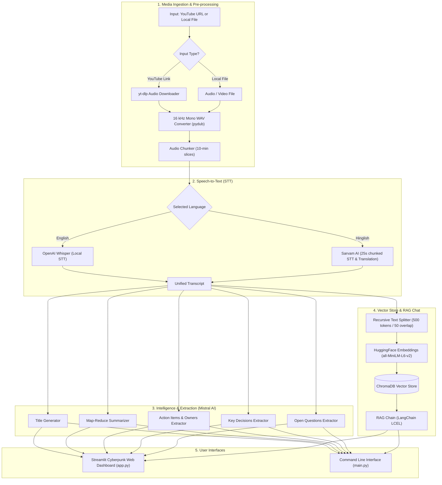

# 🎬 AI Video & Meeting Assistant

[](https://www.python.org/)
[](https://streamlit.io/)
[](https://python.langchain.com/)
[](https://mistral.ai/)
[](https://github.com/openai/whisper)
[](https://www.trychroma.com/)
[](https://opensource.org/licenses/MIT)

**AI Video Assistant** is an end-to-end meeting intelligence platform that turns recorded meetings, lectures, and YouTube videos into structured insights. It extracts audio, handles multi-language transcription (English via local Whisper and Hinglish via Sarvam AI), generates concise summaries and action items, and embeds the transcript into a local ChromaDB vector database so you can chat directly with your meetings using Retrieval-Augmented Generation (RAG).

Available as both a **modern, responsive Streamlit web dashboard** and a **standalone CLI**.

---

## ✨ Features

- **Multi-Source Ingestion**:
  - Direct download and audio extraction from YouTube links via `yt-dlp`.
  - Local video and audio file support (`.mp4`, `.mkv`, `.wav`, `.mp3`, etc.).
  - Automatic 16 kHz mono WAV conversion and segment chunking via `pydub` and `ffmpeg`.

- **Dual Speech-to-Text Engines**:
  - **English**: High-accuracy offline transcription with **OpenAI Whisper** (configurable models: `tiny` to `large`).
  - **Hinglish**: Cloud-accelerated translation and transcription to English using **Sarvam AI** (`saaras:v2.5`), with automatic 25-second audio slicing to adhere to API constraints.

- **Automated Meeting Intelligence**:
  - 🏷️ **Smart Title Generation**: Generates concise, professional session titles (max 8 words).
  - 📋 **Map-Reduce Summarisation**: Handles lengthy transcripts seamlessly by recursively summarizing chunks and consolidating them into clean bullet points.
  - ✅ **Action Items Extraction**: Identifies task descriptions, assignees/owners, and deadlines.
  - 🔑 **Key Decisions Extraction**: Surfaces crucial consensus points and agreements.
  - ❓ **Open Questions & Follow-ups**: Extracts unresolved questions and areas needing follow-up.

- **RAG-Powered Interactive Chat**:
  - Chunks and stores transcripts in a local **ChromaDB** vector database with **HuggingFace** (`all-MiniLM-L6-v2`) embeddings.
  - Query your meeting using LangChain LCEL chains with grounded citations from the transcript.
  - Built-in hallucination guardrails (explicitly states when information is not in the meeting).

- **Production-Grade Resilience**:
  - Custom `RateLimitedChatMistralAI` wrapper with exponential backoff and pacing to handle Mistral API tier rate limits gracefully.
  - Bundled fallback binary locator (`imageio-ffmpeg`) ensuring `ffmpeg` works even if not installed globally on your system.

---

## 🏗️ Architecture & Pipeline Flow



---

## 📁 Repository Structure

```text
AI-assistent/
├── app.py                  # Streamlit web dashboard with custom cyber/minimal UI
├── main.py                 # CLI interface for running the pipeline & interactive chat
├── test.py                 # Test / benchmark script for rapid pipeline verification
├── Requirements.txt        # Python dependency manifest
├── .env.example            # Template for environment variables and API keys
├── .gitignore              # Git ignore rules (.env, .venv, cache, etc.)
│
├── core/                   # Core business logic & AI orchestration
│   ├── llm.py              # Mistral LLM client with rate-limiting & backoff
│   ├── transcriber.py      # Speech-to-text routing (Whisper vs. Sarvam AI)
│   ├── summarizer.py       # Map-reduce summarization & title generation
│   ├── extractor.py        # Structured extraction (actions, decisions, questions)
│   ├── vector_store.py     # ChromaDB vector store and HuggingFace embeddings
│   └── rag_engine.py       # LangChain LCEL RAG pipeline & Q&A handler
│
├── utils/                  # Utility modules
│   └── audio_processor.py  # Media download, ffmpeg setup, WAV conversion & chunking
│
├── downloades/             # Working directory for downloaded & converted audio
└── vector_db/              # Persisted ChromaDB vectors (generated at runtime)
```

---

## 🛠️ Tech Stack

| Component | Technology | Description |
| :--- | :--- | :--- |
| **User Interface** | [Streamlit](https://streamlit.io/) | Interactive web UI with live pipeline stage badges |
| **LLM Orchestration** | [LangChain](https://www.langchain.com/) (LCEL) | Clean, composable runnables for extraction & RAG |
| **LLM Provider** | [Mistral AI](https://mistral.ai/) (`mistral-small-latest`) | High efficiency meeting analysis & Q&A |
| **Local STT** | [OpenAI Whisper](https://github.com/openai/whisper) | Offline English speech recognition (`small` model default) |
| **Indic STT & Translation** | [Sarvam AI](https://www.sarvam.ai/) (`saaras:v2.5`) | Audio translation and transcription for Hinglish |
| **Embeddings** | [HuggingFace](https://huggingface.co/) (`all-MiniLM-L6-v2`) | Lightweight, high-performance CPU-friendly embeddings |
| **Vector Database** | [ChromaDB](https://www.trychroma.com/) | Persistent vector store for RAG document retrieval |
| **Audio Processing** | [yt-dlp](https://github.com/yt-dlp/yt-dlp), [pydub](https://github.com/jiaaro/pydub), [FFmpeg](https://ffmpeg.org/) | Audio extraction, conversion, and segmentation |

---

## 🚀 Quickstart

### 1. Prerequisites

- **Python 3.10+** (Python 3.10, 3.11, 3.12, or 3.13)
- **FFmpeg**:
  - macOS: `brew install ffmpeg`
  - Ubuntu/Debian: `sudo apt update && sudo apt install ffmpeg`
  - Windows: `winget install Gyan.FFmpeg` or via [ffmpeg.org](https://ffmpeg.org/download.html)
  > *Note: If a system FFmpeg is not found, the project automatically links the bundled binary from `imageio-ffmpeg` to `.bin/ffmpeg`.*

### 2. Clone the Repository

```bash
git clone https://github.com/your-username/AI-assistent.git
cd AI-assistent
```

### 3. Create a Virtual Environment

```bash
# Create virtual environment
python3 -m venv .venv

# Activate on macOS / Linux:
source .venv/bin/activate

# Or on Windows (Command Prompt / PowerShell):
# .venv\Scripts\activate
```

### 4. Install Dependencies

```bash
pip install --upgrade pip
pip install -r Requirements.txt
```

> **Python 3.13 Users**: `Requirements.txt` includes `audioop-lts` to maintain compatibility with `pydub` after the standard library `audioop` deprecation in Python 3.13.

---

## ⚙️ Configuration

Copy the example environment file and configure your API keys:

```bash
cp .env.example .env
```

Open `.env` in your editor and add your credentials:

```dotenv
# Required: Mistral AI API Key for summarization, extraction, and RAG chat
# Obtain from https://console.mistral.ai/
MISTRAL_API_KEY="your-mistral-api-key"

# Optional (Required if using Hinglish transcription):
# Obtain from https://www.sarvam.ai/
SARVAM_API_KEY="your-sarvam-api-key"

# Optional settings:
WHISPER_MODEL="small"          # tiny | base | small | medium | large
SARVAM_STT_MODEL="saaras:v2.5" # Sarvam speech model name
```

---

## 💻 Running the Application

### Option A: Streamlit Web Dashboard (Recommended)

Start the dark-mode web application:

```bash
streamlit run app.py
```

Open your browser at `http://localhost:8501`.
1. Enter a **YouTube URL** or paste the absolute path to a local audio/video file.
2. Select your language (**English** for Whisper, **Hinglish** for Sarvam AI).
3. Click **⚡ Analyse** and observe real-time pipeline progress in the sidebar.
4. Review generated title, summary, action items, key decisions, and full transcript.
5. Ask questions in the **Chat with your Meeting** section.

---

### Option B: Command Line Interface (CLI)

Run the end-to-end pipeline directly in your terminal:

```bash
python main.py
```

Follow the prompts:
```text
Enter YouTube URL or local file path: https://www.youtube.com/watch?v=example
Language (english/hinglish): english
```
Once processing finishes, the CLI displays your meeting deliverables and opens an interactive Q&A session:
```text
💬 Chat with your meeting (type 'exit' to quit)

You: Who is responsible for the API deployment?
🤖 Assistant: John Doe is scheduled to deploy the API by Friday afternoon.
```

---

### Option C: Quick Pipeline Test

You can quickly verify that your models and audio stack are functioning properly using `test.py`:

```bash
python test.py
```

---

## 🛡️ Key Components & Design Choices

### 1. Robust Rate-Limiting (`core/llm.py`)
Free/experiment tier LLM keys often have strict requests-per-minute constraints. The included `RateLimitedChatMistralAI` wrapper:
- Enforces an inter-call spacing interval (`_MIN_GAP_SECONDS = 1.5s`).
- Catches HTTP `429 Too Many Requests` status codes.
- Inspects `Retry-After` headers and executes exponential backoff with jitter across 6 retries.

### 2. Audio Pipeline & Chunking (`utils/audio_processor.py`)
Large audio files are sliced into 10-minute segments before transcription to prevent memory spikes. When Hinglish mode is selected, chunks are further partitioned into 25-second pieces to respect Sarvam's 30-second API limit, then seamlessly reconstructed.

### 3. Map-Reduce Summarization (`core/summarizer.py`)
Rather than risking context overflow on lengthy transcripts, the system splits transcripts into 3,000-character segments with 200-character overlap, summarizes each segment, and runs a secondary reduction pass to synthesize a cohesive bulleted executive summary.

### 4. Grounded RAG Chat (`core/rag_engine.py`)
The RAG chain indexes meeting chunks with ChromaDB. Answers are constrained strictly to the provided context, preventing hallucinated assertions about decisions or dates that were not discussed.

---

## 🤝 Contributing

Contributions are welcome! If you would like to contribute:
1. Fork the repository.
2. Create your feature branch (`git checkout -b feature/amazing-feature`).
3. Commit your changes (`git commit -m "Add amazing feature"`).
4. Push to the branch (`git push origin feature/amazing-feature`).
5. Open a Pull Request.

---

## 📄 License

This project is licensed under the MIT License — see the [LICENSE](LICENSE) file for details.
